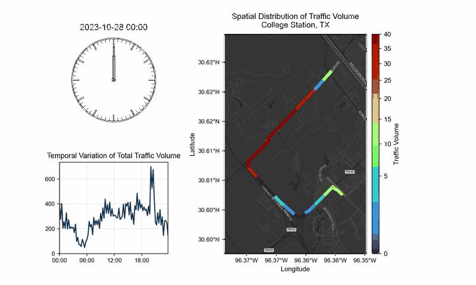
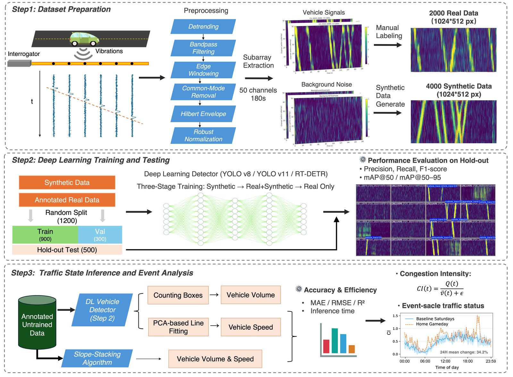
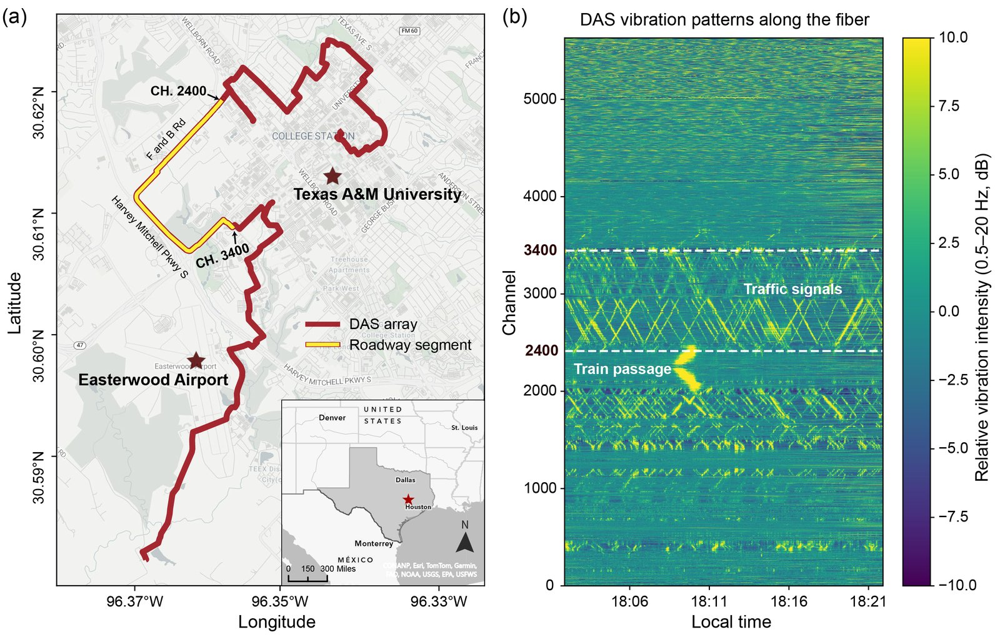
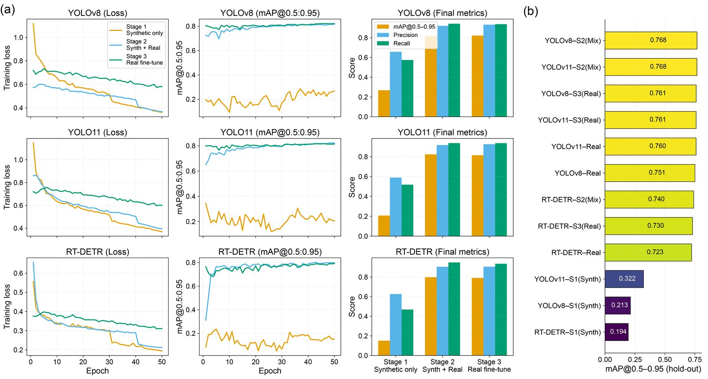
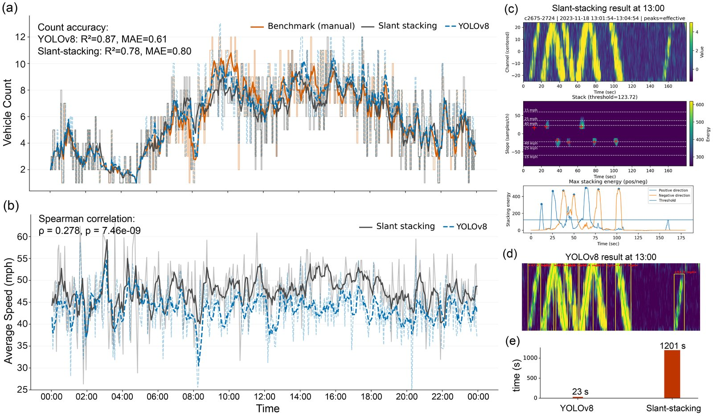
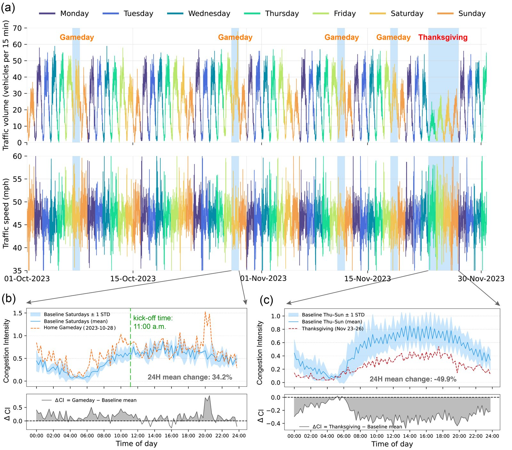
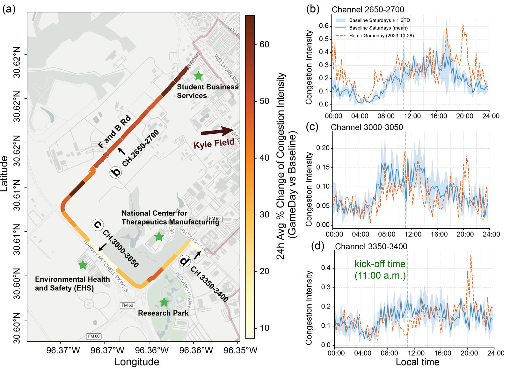
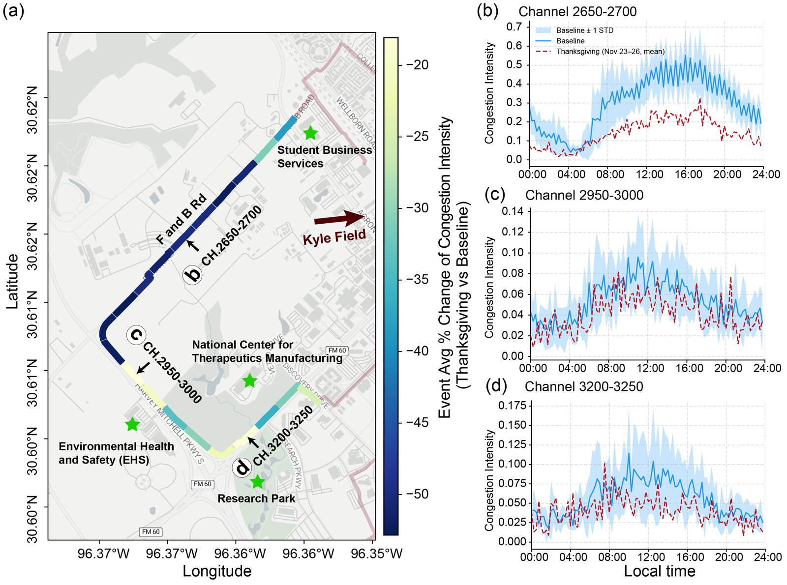

# Monitoring Urban Traffic Dynamics with DAS and Deep Learning

**Monitoring urban traffic dynamics at high spatiotemporal resolution using Distributed Acoustic Sensing and deep learning**

<p align="center">
  
</p>

Distributed Acoustic Sensing (DAS) turns an existing underground fiber-optic cable into thousands of vibration sensors spaced a few meters apart. Vehicles driving over the fiber leave straight, bright trajectories in DAS space-time images. This repository contains the code that detects these trajectories with deep learning, estimates vehicle counts and apparent speeds from them, and aggregates the results into roadway-level traffic states. The study area is a DAS array on the Texas A&M University campus in College Station, Texas. The data cover October–November 2023.

The animation above shows traffic volume on each 200 m roadway segment through the day of a home football game (Oct 28, 2023).

**Key findings**

- A hybrid training strategy (synthetic pre-training, then synthetic + real, then real only) raises mAP@0.5–0.95 on the hold-out set from below 0.35 with synthetic data alone to about 0.77. YOLOv8 and YOLO11 perform best.
- Deep-learning vehicle counts match manual annotations better than conventional slant stacking (r = 0.931 vs 0.882, MAE = 0.61 vs 0.80). Inference is about 50× faster (23 s vs 1201 s).
- **Congestion intensity** (volume ÷ speed) separates event types clearly. Over the full day, it rose by 34.2 % on a home football gameday and fell by 49.9 % over Thanksgiving, compared with matched baseline days.
- The response varies strongly from segment to segment. The main arterial toward Kyle Field (F&B Road) shows the largest gameday increase and the strongest Thanksgiving reduction.

---

## Workflow

<p align="center">
  
</p>

| Step | Module | What it does |
|---|---|---|
| 1 · Dataset preparation | `detection.split_dataset` | splits annotated 180 s × 50-channel images into YOLO train / val / test |
| 2 · Training and testing | `detection.py` | three-stage training of YOLOv8 / YOLO11 / RT-DETR, training summary, hold-out evaluation |
| 3 · Traffic-state inference | `speed_estimation.py` | detector inference, then PCA line fit in each box to get signed apparent speed |
| | `slant_stack.py` | conventional 4th-root slant-stacking benchmark (vehicle count and speed) |
| | `traffic_metrics.py` | validation against manual labels, 15-min network series, per-segment aggregation, event vs. baseline congestion intensity |
| | `geometry.py` | KMZ fiber route → channels → 50-channel roadway segments (GeoJSON) |

## Study area

<p align="center">
  
</p>

About 23 km of fiber runs along roads, campus facilities and a rail corridor. The analysis uses channels 2400–3400, spaced 4 m apart, split into twenty 50-channel (≈200 m) roadway segments. Raw waveforms are preprocessed in the following order:

1. detrending
2. 0.5–20 Hz band-pass filtering
3. edge tapering
4. common-mode noise removal
5. Hilbert envelope
6. robust normalization

The result is cut into 180 s × 50-channel images.

## Results

### Detection models

<p align="center">
  
</p>

Three-stage training of YOLOv8, YOLO11 and RT-DETR:

- **(a)** Training loss and mAP@0.5–0.95 convergence.
- **(b)** mAP@0.5–0.95 on the independent 500-image hold-out set.

### Vehicle volume and speed

<p align="center">
  
</p>

YOLOv8 (Stage 2) compared with slant stacking and manual annotations on Nov 18, 2023. The figure also shows example detections and the inference-time comparison.

### Event-driven traffic dynamics

<p align="center">
  
</p>

Traffic volume and speed over October–November 2023, colored by weekday. Shaded bands mark home gamedays and Thanksgiving. The lower panels compare diurnal congestion intensity with matched baselines (mean ± 1 SD):

- **(b)** Home gameday on Oct 28 vs non-gameday Saturdays.
- **(c)** Thanksgiving (Nov 23–26) vs non-event Thursday–Sunday periods.

### Spatial heterogeneity

<p align="center">
  
  
</p>

Per-segment change in congestion intensity relative to baseline on the gameday (left) and over Thanksgiving (right), with diurnal profiles of selected segments.

---

## Repository structure

```
config.py              paths (via DAS_DATA_ROOT), image geometry, segments, event and baseline dates
detection.py           dataset split, three-stage training, training summary, hold-out evaluation
speed_estimation.py    YOLO inference + PCA speed; same estimation on manual labels (benchmark)
slant_stack.py         4th-root slant stacking on .npy windows (conventional benchmark)
traffic_metrics.py     validation metrics, network time series, segment aggregation, event analysis
geometry.py            fiber KMZ → channels → segment polylines / GeoJSON
docs/images/           figures shown in this README
```

## Getting started

```bash
conda create -n das python=3.10
conda activate das
pip install -r requirements.txt          # install a CUDA build of PyTorch first for GPU training

export DAS_DATA_ROOT=/path/to/data       # default: ./data   (layout in config.py)
export DAS_OUTPUT_DIR=/path/to/outputs   # default: ./outputs
export DAS_DEVICE=0                      # GPU index or "cpu"
```

Pretrained checkpoints (`yolov8s.pt`, `yolo11s.pt`, `rtdetr-l.pt`) are downloaded by Ultralytics automatically. You can also place them in `./weights`.

**Detection**

```bash
python detection.py split                 # labelled images -> dataset_split/ + dataset_real.yaml
python detection.py train                 # three-stage + real-only training for all architectures
python detection.py summary               # outputs/training_summary.csv
python detection.py holdout               # hold-out P / R / mAP for every run
```

**Speed estimation**

```bash
python speed_estimation.py days                                   # all days in data/images/<YYYYMMDD>
python speed_estimation.py benchmark --images … --labels … --out …  # manual-label benchmark
python slant_stack.py --npy data/npy/20231118 --out data/results_slant/20231118
```

**Traffic metrics**

```bash
python traffic_metrics.py validate --benchmark … --slant …/vehicles.csv --yolo …/speeds.csv
python traffic_metrics.py agreement --slant … --yolo …            # 30-min agreement (Fig. S3–S4)
python traffic_metrics.py aggregate                               # per-segment 15-min tables
python traffic_metrics.py events --yolo oct/speeds.csv nov/speeds.csv
```

## Data

The DAS recordings, annotated images and trained weights are **not** included in this repository. Expected folder names are listed in `config.py`. Images are named `<id>_c<ch0>-<ch1>_<YYYYMMDDTHHMMSS>_<YYYYMMDDTHHMMSS>.png`, and the time and channel span are parsed from these names.

Two steps are not part of this repository:

- preprocessing raw DAS waveforms into 180 s images
- generating the 4,000 synthetic training images

## Citation

The manuscript is currently under review. The citation will be added after publication.

## License

Code: MIT, see [LICENSE](LICENSE). Figures © the authors.

## Contact

Hao Tian — Texas A&M University · haotian@tamu.edu
